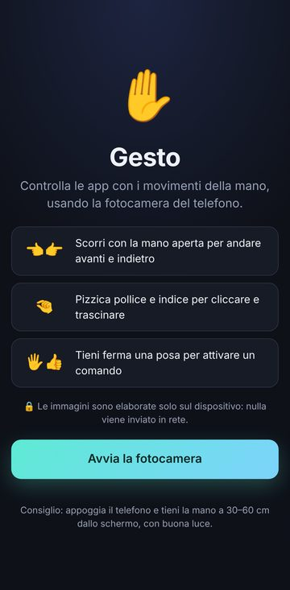
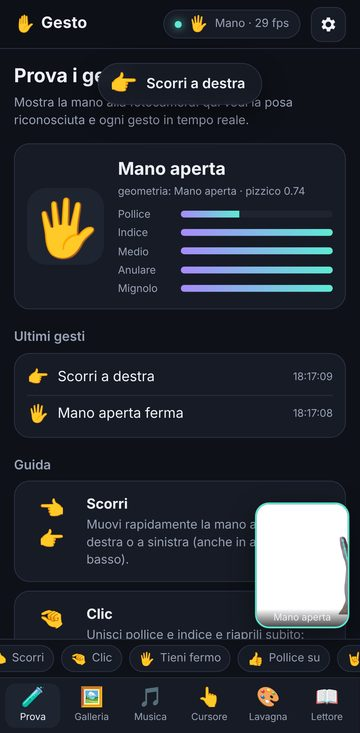
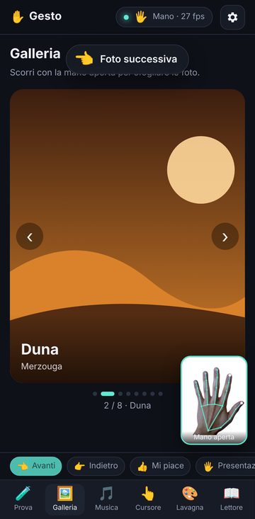
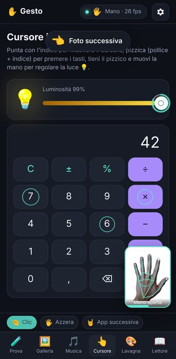
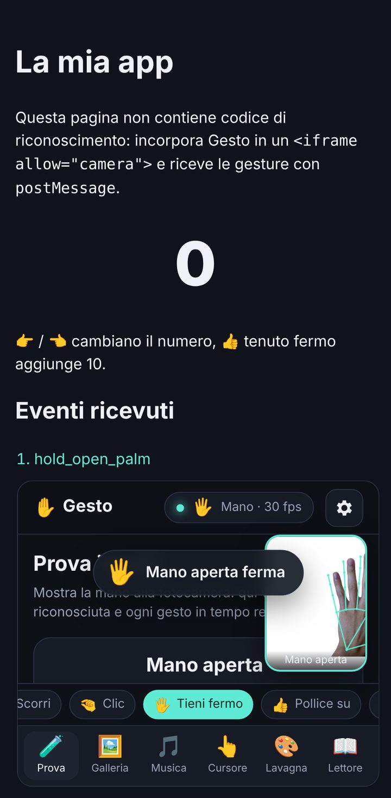

# ✋ Gesto — controlla le app con le mani

Web app per smartphone (browser moderni: Chrome/Android, Safari/iOS 16.4+, Firefox,
Edge) che usa la fotocamera per riconoscere **la mano e i suoi movimenti** e
trasformarli in **comandi per le applicazioni**: scorrere, cliccare, trascinare,
play/pausa, volume… senza toccare lo schermo.

Tutto avviene **sul dispositivo** (WebAssembly + GPU): nessuna immagine viene
inviata in rete. È una PWA: si installa sulla schermata Home e funziona anche offline.

<p>




</p>

## Gesti riconosciuti

| Gesto | Come si fa | Evento |
|---|---|---|
| 👈 👉 👆 👇 Swipe | Muovi rapidamente la **mano aperta** a sinistra/destra/su/giù | `swipe_left` … `swipe_down` |
| 🤏 Clic | Unisci **pollice e indice** e riaprili subito | `tap` |
| 🤏↕️ Trascina | Tieni pollice e indice uniti e muovi la mano | `pinchstart` / `pinchmove` / `pinchend` |
| ☝️ Cursore | La punta dell'indice muove un cursore sullo schermo | `pointer` |
| ⏱️ Tieni fermo | Mantieni ferma una posa per ~0,8 s (ripete se continui) | `hold_open_palm`, `hold_fist`, `hold_point`, `hold_victory`, `hold_thumb_up`, `hold_thumb_down`, `hold_rock` |

Pose statiche: 🖐️ mano aperta, ✊ pugno, ☝️ indice, ✌️ vittoria, 👍 pollice su,
👎 pollice giù, 🤘 corna, 🤏 pizzico. Ovunque, 🤘 tenuto fermo passa all'app successiva.

## App dimostrative

| App | Cosa mostra |
|---|---|
| 🧪 **Prova** | Posa riconosciuta, estensione di ogni dito, registro dei gesti, guida |
| 🖼️ **Galleria** | Swipe per sfogliare, 👍 per "mi piace", 🖐️ per la presentazione automatica |
| 🎵 **Musica** | Lettore (sintetizzatore Web Audio): 🖐️ play/pausa, swipe cambio brano, 👍/👎 volume |
| 👆 **Cursore** | Mouse "in aria": indice = cursore, pizzico = clic (calcolatrice), pizzico e muovi = slider |
| 🎨 **Lavagna** | Disegno in aria col pizzico; ✌️ cambia colore, 🖐️ cancella, 👍 annulla |
| 📖 **Lettore** | Swipe su/giù per sfogliare, pizzica e trascina per scorrere, 👍/👎 dimensione testo |

Con l'opzione **"Cursore con il dito in tutte le app"** il cursore in aria
comanda qualsiasi pulsante dell'interfaccia (anche la barra delle app e le
impostazioni); pizzicare e trascinare su un'area vuota scorre la pagina.

## Provarla sul telefono

La fotocamera nel browser funziona solo su pagine **HTTPS** (o `localhost`).

1. **GitHub Pages (consigliato).** In *Settings → Pages* scegli una delle due fonti:
   - *Deploy from a branch*: il branch con l'app e la cartella `/ (root)`
     (nessuna build: il file `.nojekyll` fa pubblicare i file così come sono);
   - *GitHub Actions*: il workflow `.github/workflows/pages.yml` pubblica l'app a
     ogni push su `main` (o manualmente da *Actions → Deploy su GitHub Pages → Run workflow*).

   L'indirizzo è `https://<utente>.github.io/<repository>/`. Aprilo dal telefono e,
   se vuoi, *Aggiungi a schermata Home*. (Pages su repository privati richiede un
   piano GitHub a pagamento.)
2. **Dal computer, con il ponte PC** (vedi sotto): `npm run bridge` serve l'app in
   HTTPS sulla rete locale e stampa l'indirizzo da aprire sul telefono.
3. **In locale**: `npm start` e apri `http://localhost:8080` sul computer (la
   webcam va bene per provare). Per il telefono serve un tunnel HTTPS (es.
   `cloudflared tunnel --url http://localhost:8080`).

Consigli: buona luce, mano a 30–60 cm dalla fotocamera, telefono appoggiato.
Tocca l'anteprima della fotocamera per spostarla nell'altro angolo.

## Controllare altre applicazioni

Le gesture non restano chiuse in Gesto: ci sono quattro modi per usarle altrove.

### 1. Libreria JavaScript per la tua web app

```html
<video id="cam" playsinline muted></video>
<script type="module">
  import { GestureController } from './src/gesture-control.js';

  const gc = new GestureController({ video: document.getElementById('cam') });
  gc.on('gesture', ({ id, repeat }) => {
    if (id === 'swipe_left') nextSlide();
    if (id === 'swipe_right') previousSlide();
    if (id === 'hold_open_palm' && !repeat) togglePlay();
  });
  gc.on('pointer', ({ x, y, pinching }) => moveCursor(x, y)); // 0..1, dal punto di vista dell'utente
  await gc.start(); // da chiamare dopo un tocco dell'utente
</script>
```

Esempio completo: [`examples/slides.html`](examples/slides.html). Il motore
(`src/core/engine.js`) è indipendente da DOM e fotocamera: si può alimentare con
landmark registrati o di altre fonti (`engine.process({ timestamp, hands })`).

Opzioni utili: `facingMode` (`user`/`environment`), `numHands`, `delegate`
(`GPU`/`CPU`, con ripiego automatico sulla CPU se la GPU è lenta),
`engine: { swipe: {...}, hold: { ms }, pinch: {...}, pointer: { margin } }`
(vedi `DEFAULT_OPTIONS` in `src/core/engine.js`). Metodi: `start()`, `stop()`,
`pause()`, `resume()`, `switchCamera()`.

### 2. Incorporare Gesto in un'altra pagina (iframe + postMessage)

```html
<iframe src="https://<tuo-sito>/index.html" allow="camera"></iframe>
<script>
  addEventListener('message', (e) => {
    if (e.data?.source === 'gesto' && e.data.type === 'gesture') console.log(e.data.id);
  });
</script>
```

Gesto invia alla pagina che lo contiene `gesture`, `pose` e `pointer`. Esempio:
[`examples/embed.html`](examples/embed.html).



### 3. Altre schede e la pagina stessa

Nelle impostazioni: **BroadcastChannel** (`new BroadcastChannel('gesto')` riceve
gli stessi messaggi in altre schede dello stesso sito) e **Simula tasti nella
pagina** (frecce, spazio, Invio… come eventi tastiera).

### 4. Ponte PC: le gesture diventano tasti veri sul computer

Usa il telefono come telecomando gestuale per presentazioni (PowerPoint,
Keynote, Google Slides), video (YouTube, VLC), musica.

```bash
npm run bridge            # oppure: node bridge/server.mjs --port 8443
```

Il ponte (Node ≥ 20, nessuna dipendenza):

- crea un certificato HTTPS autofirmato con `openssl` e serve l'app sulla rete locale;
- stampa un indirizzo come `https://192.168.1.10:8443/?bridge=3f9c2a1b7d4e`: aprilo
  sul telefono (stessa Wi‑Fi), accetta l'avviso del certificato e avvia la fotocamera;
- riceve le gesture via WebSocket, **solo con il token** contenuto nell'indirizzo;
- preme i tasti con `xdotool` (Linux/X11), `osascript` (macOS: concedi
  *Accessibilità* al Terminale) o PowerShell `SendKeys` (Windows).

Mappa predefinita:

| Gesto | Tasto |
|---|---|
| `swipe_left` / `swipe_right` | → / ← (slide successiva/precedente) |
| `swipe_up` / `swipe_down` | Pagina giù / Pagina su |
| `hold_open_palm` | Spazio (play/pausa) |
| `hold_fist` | Esc |
| `hold_thumb_up` / `hold_thumb_down` | Volume + / − (ripetuto finché tieni) |
| `hold_victory` | Play/Pausa multimediale |

Personalizzala con un file JSON (`node bridge/server.mjs --map mappa.json`), ad
esempio `{ "tap": "Enter", "hold_rock": "F5" }`; `--help` elenca i tasti
disponibili, `--dry-run` mostra i tasti senza premerli.

## Come funziona

```
fotocamera ─► MediaPipe GestureRecognizer (WASM/GPU) ─► 21 punti della mano
           ─► classificatore geometrico (+ modello)  ─► posa (mano aperta, pugno…)
           ─► motore temporale                        ─► swipe, pizzico/clic, trascina, tieni fermo, cursore
           ─► app / iframe / BroadcastChannel / ponte PC
```

- **Pose**: per ogni dito si confronta la distanza polso→punta con quella
  polso→articolazione centrale e si misura quanto è dritto. Il risultato non
  dipende da distanza e rotazione della mano (il modello di MediaPipe riconosce
  solo mani dritte: le due fonti sono fuse).
- **Swipe**: spostamento del palmo di almeno 1/5 dell'inquadratura in meno di
  0,45 s, con un asse dominante; il "colpo di ritorno" subito dopo viene ignorato.
- **Pizzico**: soglie diverse per chiudere/aprire (isteresi); il clic usa la
  posizione del dito di un istante prima, il trascinamento segue il palmo.
- **Cursore**: filtro One Euro (stabile da fermo, reattivo in movimento) e solo
  la zona centrale dell'inquadratura viene mappata sullo schermo.
- Front camera specchiata: destra/sinistra sono sempre dal punto di vista dell'utente.
- Lo schermo resta acceso (Wake Lock) mentre la fotocamera è attiva.

## Struttura

```
index.html, css/, sw.js, manifest.webmanifest   app (PWA, nessun passaggio di build)
src/gesture-control.js                          API pubblica (GestureController)
src/core/                                       fotocamera, MediaPipe, classificatore, motore
src/ui/                                         cursore in aria, integrazioni, impostazioni
src/apps/                                       le sei app dimostrative
bridge/                                         ponte PC (HTTPS + WebSocket + tasti)
examples/                                       integrazioni d'esempio
vendor/mediapipe/, models/                      runtime e modello MediaPipe (Apache 2.0)
tests/                                          test unitari ed end-to-end
```

## Sviluppo e test

```bash
npm start          # server locale su http://localhost:8080
npm test           # test unitari (node:test) su landmark di mani reali
npm run test:e2e   # end-to-end in Chromium headless (richiede Playwright e ffmpeg)
```

I test end-to-end usano una **fotocamera finta**: un video generato con ffmpeg
da una foto reale di una mano che sta ferma e poi scorre di lato. Verificano
l'intera catena (fotocamera → MediaPipe → gesti → interfaccia), il cursore in
aria (clic sulla calcolatrice, trascinamento dello slider, scorrimento), gli
esempi d'integrazione e il ponte PC. I landmark usati nei test unitari si
rigenerano con `node tests/fixtures/generate-landmarks.mjs`.

## Se la mano non viene riconosciuta

L'app si adatta da sola ai problemi più comuni dei browser per telefono:

- passa a MediaPipe una copia del fotogramma su canvas (su Safari il caricamento
  diretto del video in WebGL può dare immagini nere) e, se anche il canvas
  risulta nero, prova con il video;
- se la GPU dà errori, è lenta o non vede mani che la CPU invece trova
  (verifica periodica sullo stesso fotogramma), passa alla CPU;
- se il ciclo dei fotogrammi si ferma, lo riavvia con `requestAnimationFrame`.

Nell'app **Prova** la scheda **🩺 Diagnostica** (si apre da sola se dopo qualche
secondo non è stata trovata nessuna mano) mostra fotogrammi analizzati,
luminosità, mani trovate, errori e browser; il pulsante **Copia** copia tutto,
**Usa la CPU / GPU** cambia motore al volo.

## Limiti noti

- Serve buona luce; controluce e sfondi molto confusi riducono la precisione.
- Su telefoni datati il riconoscimento può scendere a 10–15 fotogrammi al
  secondo: gli swipe vanno fatti un po' più lenti (o scegli sensibilità "Alta").
- Il ponte PC su Linux richiede X11 (`xdotool`); su Wayland non funziona.
- Il browser non può controllare le app native del telefono: per quelle si usa
  il ponte (verso il computer) oppure si integra la libreria nella propria web app.

Componenti di terze parti: vedi [`vendor/mediapipe/NOTICE.md`](vendor/mediapipe/NOTICE.md).
